# AWS Cloud Computing Notes

This repository contains a chapter-wise study guide for AWS and cloud computing. 

## 1. Why This Matters

Modern applications do not live in isolation. They need:

- Servers and compute capacity
- Storage and databases
- Security and identity
- Network connectivity
- Scalability and high availability
- Monitoring and backups

Before cloud computing, companies had to buy and maintain physical infrastructure on-premises. That meant:

- Huge upfront investment
- Maintenance of servers and racks
- Power backup and networking
- Hardware failures and downtime
- Difficult scaling during traffic spikes
- High operational burden

Cloud computing solved this by letting companies use infrastructure over the internet on a pay-as-you-go model.

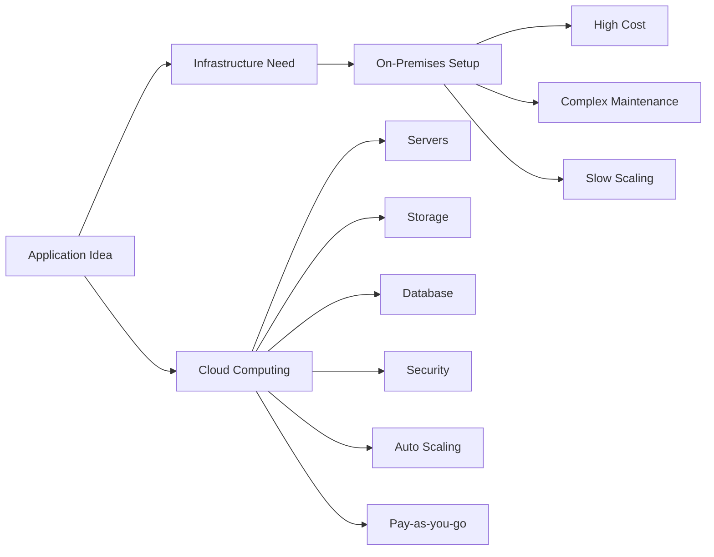

---

## 2. What is Cloud Computing?

Cloud computing is the delivery of computing resources over the internet. Instead of buying expensive hardware, you rent the required services such as:

- Compute
- Storage
- Databases
- Networking
- Security
- Monitoring
- Scaling

### Simple analogy

Using electricity is like using cloud computing:

- You do not build a power plant to use electricity.
- You use what you need, when you need it.
- You pay for usage instead of buying everything upfront.

### Key benefits

- Cost optimization
- Fast deployment
- Elastic scalability
- High availability
- Global reach
- Reduced infrastructure operations

### Cloud characteristics

- On-demand self-service
- Broad network access
- Resource pooling
- Rapid elasticity
- Measured service

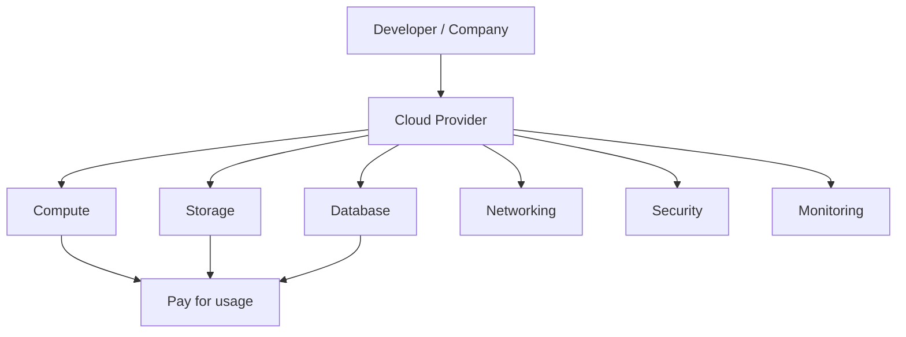

---

## 3. Overview of AWS

AWS (Amazon Web Services) is the most popular cloud platform. It offers infrastructure and managed services for running applications at scale.

### Why AWS?

- Massive global infrastructure
- Wide range of services
- Secure and scalable
- Enterprise-ready
- Flexible pricing
- Strong ecosystem

### Core AWS idea

AWS provides building blocks that allow you to assemble your application architecture using managed services.

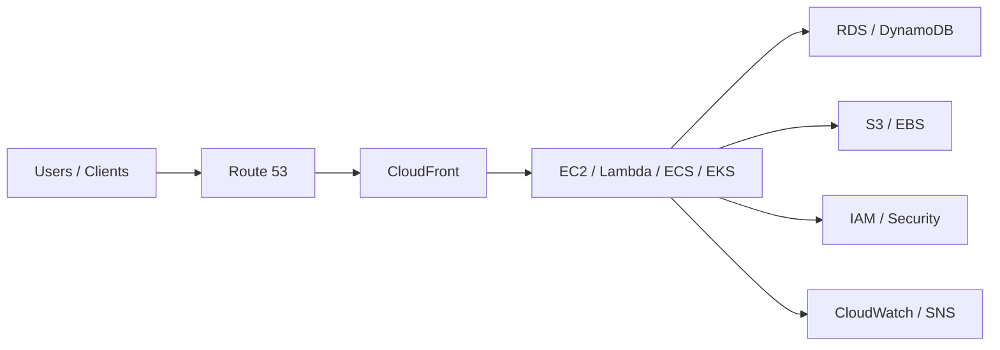

---

## 4. AWS Identity and Access Management (IAM)

IAM is AWS's identity management service.

### Purpose

- Manage users and groups
- Grant access permissions securely
- Control who can do what in AWS
- Create least-privilege access policies

### Important concepts

- Users: individual identities
- Groups: organize users
- Roles: temporary permissions for services and users
- Policies: rules that define permissions
- MFA: multi-factor authentication
- Root user: account owner with full access

### Best practices

- Do not use root user for day-to-day work
- Use least-privilege permissions
- Turn on MFA
- Rotate credentials
- Use roles instead of static keys where possible

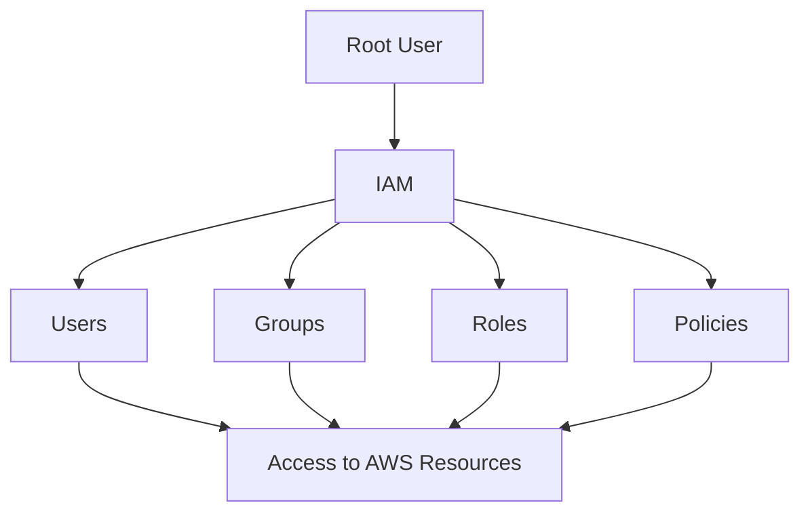

---

## 5. Amazon EC2 (Elastic Compute Cloud)

EC2 provides virtual servers in the cloud.

### Why EC2 is important

It is one of the most foundational AWS services and is used to run application workloads.

### EC2 features

- Virtual machines in the cloud
- Different instance types
- Flexible operating systems
- CPU, memory, storage choices
- Elastic IPs, security groups, and networking
- Pay-as-you-go billing

### Common EC2 use cases

- Web servers
- Application servers
- API backends
- Jenkins build agents
- Batch workloads

### Key AWS networking ideas with EC2

- Security Groups: act like firewall rules for EC2
- VPC: virtual private cloud for isolated networking
- Internet Gateway: allows internet access
- NAT Gateway: allows private instances to access internet securely
- Public IP: internet-facing address
- Private IP: internal network address

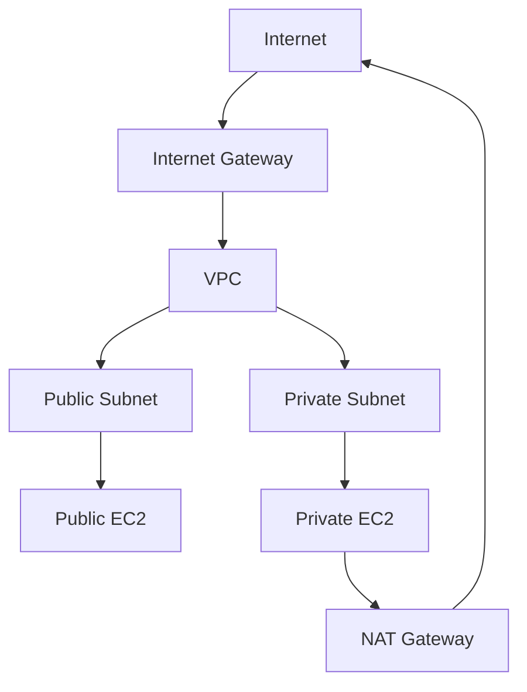

---

## 6. Amazon EBS and AMI

### Amazon EBS

EBS is a block storage service attached to EC2 instances.

#### Features

- Persistent storage
- Attached to EC2
- Suitable for databases and application workloads
- Snapshots for backup and recovery

### AMI (Amazon Machine Image)

AMI is a pre-configured image used to launch EC2 instances.

#### Use cases

- Reusing a configured server
- Creating golden images
- Deploying identical environments

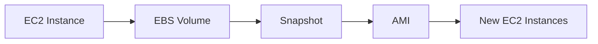

---

## 7. ELB and Auto Scaling Group (ASG)

### Elastic Load Balancer (ELB)

ELB distributes traffic across multiple EC2 instances.

#### Benefits

- Handles traffic distribution
- Increases availability
- Reduces downtime
- Supports health checks

### Auto Scaling Group (ASG)

ASG automatically adds or removes EC2 instances based on traffic demand.

#### Benefits

- Scales in and out automatically
- Keeps apps healthy
- Handles traffic surges
- Reduces cost during low traffic

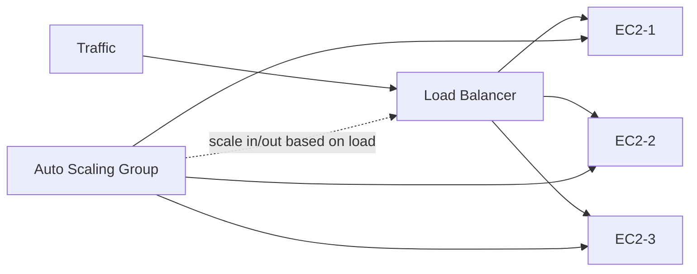

---

## 8. Amazon S3 (Simple Storage Service)

S3 is AWS's object storage service.

### Why it matters

It is used for static websites, backups, logs, data lakes, and content storage.

### Features

- Highly durable storage
- Easy to store files and objects
- Very scalable
- Versioning
- Lifecycle policies
- Bucket-based storage model

### Common use cases

- Website hosting
- File storage
- Backup and archival
- Media distribution
- Logs and data analytics

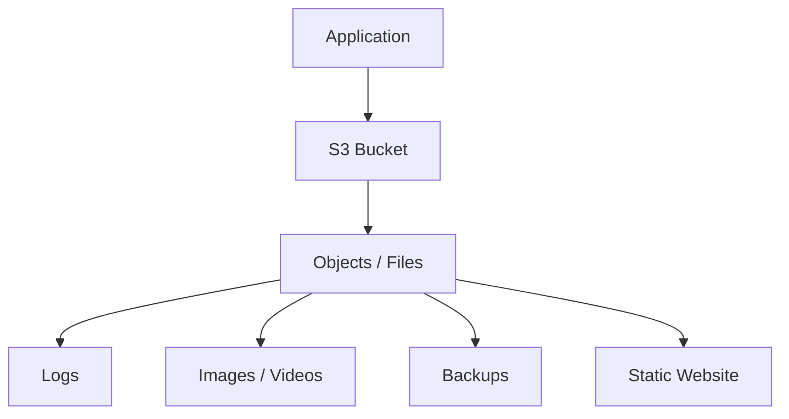

---

## 9. Amazon RDS

RDS is a managed relational database service.

### Supported engines

- MySQL
- PostgreSQL
- MariaDB
- Oracle
- SQL Server

### Benefits

- Managed backups
- Automatic patching
- Monitoring
- Easy scaling
- High availability options

### Use cases

- Transactional applications
- Business applications
- ERP / finance systems
- Apps requiring relational data consistency

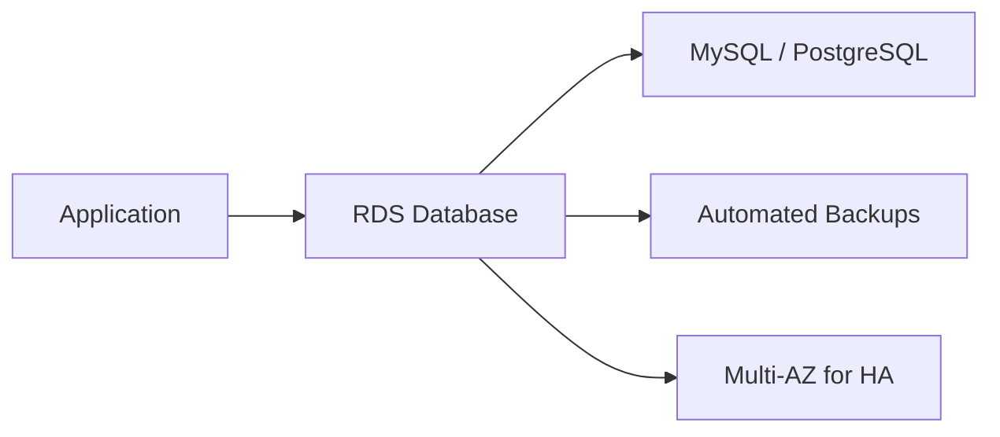

---

## 10. Amazon DynamoDB

DynamoDB is AWS's fully managed NoSQL database.

### Characteristics

- Fast and scalable
- Key-value and document data model
- Serverless-friendly
- High performance at scale
- Suitable for modern application workloads

### Use cases

- User sessions
- Shopping carts
- IoT data
- Gaming leaderboards
- Event-driven apps

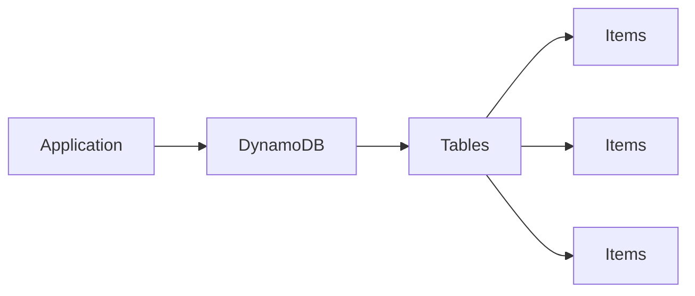

---

## 11. AWS Lambda

Lambda is a serverless compute service.

### Core idea

You write code and AWS runs it in response to events, without managing servers.

### Common use cases

- API backend
- File processing
- Event-driven automation
- Data transformation
- Scheduled jobs

### Benefits

- No server management
- Automatic scaling
- Pay per invocation
- Great for microservices and automation

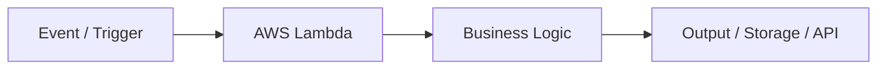

---

## 12. AWS CloudFormation

CloudFormation is AWS's Infrastructure as Code (IaC) service.

### Purpose

It helps you define and provision AWS resources through templates.

### Benefits

- Repeatable deployment
- Version-controlled infrastructure
- Less manual effort
- Consistent environments

### Typical resources

- EC2
- VPC
- Security Groups
- S3 Buckets
- IAM Roles

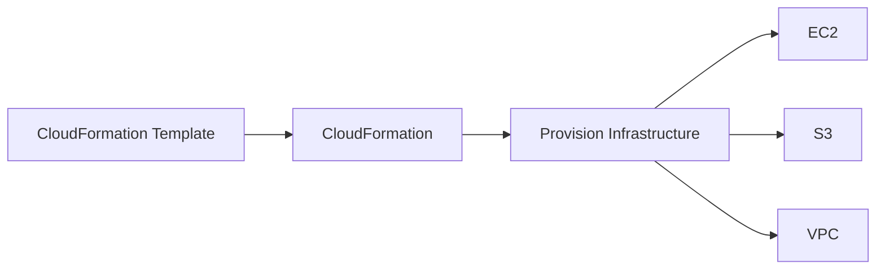

---

## 13. Route 53

Route 53 is AWS's Domain Name System (DNS) service.

### Purpose

- Route traffic to AWS services and external endpoints
- Manage domain records
- Support health checks

### Common records

- A record
- CNAME
- Alias
- MX
- TXT

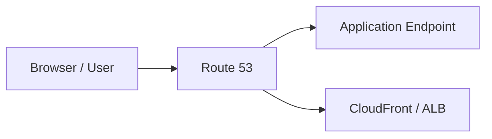

---

## 14. AWS CloudFront

CloudFront is AWS's content delivery network (CDN).

### Purpose

It caches content near users to reduce latency and improve performance.

### Benefits

- Faster content delivery
- Lower latency
- Global edge locations
- Better user experience

### Use cases

- Websites
- Media streaming
- APIs
- Static content distribution

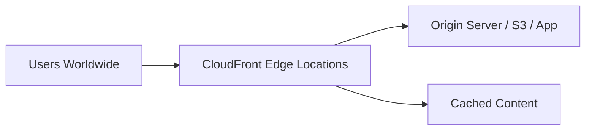

---

## 15. Additional AWS Services in the Course

### AWS Amplify

A service focused on frontend app development with hosting, CI/CD, and authentication support.

### Amazon ECS

Elastic Container Service for running Docker containers.

### Amazon EKS

Elastic Kubernetes Service for running Kubernetes-based workloads in AWS.

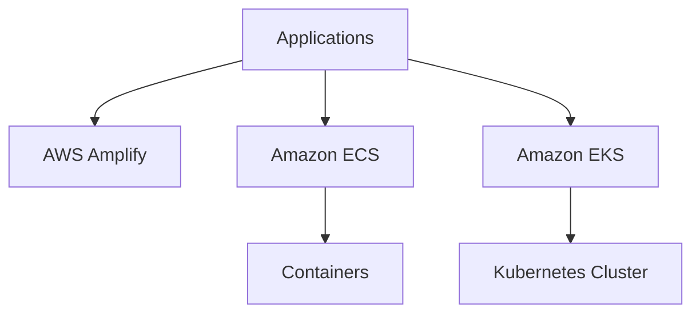

---

## 16. End-to-End AWS Architecture Flow

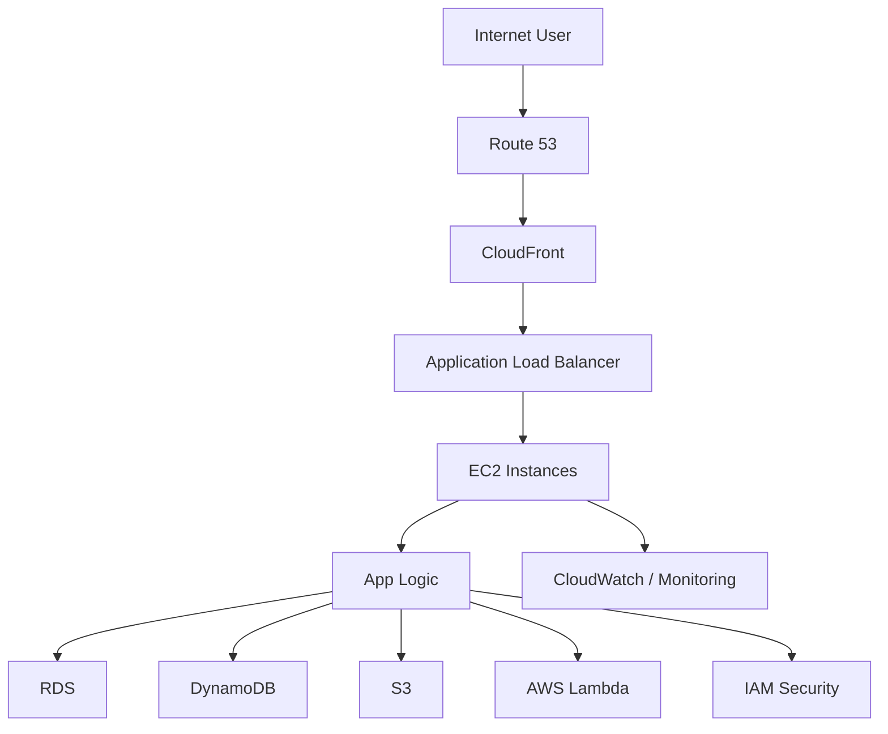

This diagram shows a typical flow for a modern application running on AWS using multiple managed services.

---

## 17. Study Tips

- Start with the fundamentals: cloud, AWS, IAM, VPC, EC2.
- Learn service categories: compute, storage, databases, network, security.
- Understand problem-to-solution mapping: what service solves which problem?
- Practice with real architecture examples.
- Use diagrams to remember service relationships.
- Focus on AWS core services before moving to advanced services.

---

## 18. Quick Summary Cheat Sheet

| Area | Core AWS Service | Purpose |
|------|-----------------|---------|
| Identity & Access | IAM | Manage users, roles, access |
| Compute | EC2 | Virtual servers |
| Storage | S3 | Object storage |
| Block Storage | EBS | Persistent attached storage |
| Database (Relational) | RDS | Managed SQL database |
| Database (NoSQL) | DynamoDB | Fast NoSQL database |
| Serverless | Lambda | Run code without servers |
| Containers | ECS / EKS | Run containers / Kubernetes |
| Networking | VPC / Route 53 | Private networking and DNS |
| CDN | CloudFront | Fast global content delivery |
| Deployment | CloudFormation | Infrastructure as code |
| Scaling | ASG + ELB | Auto-scale and distribute traffic |

---

## 19. Final Takeaway

AWS is not just a set of services. It is a complete platform for building, deploying, scaling, and securing modern applications. The most important idea is this:

> Cloud computing lets you focus on building products and solving business problems, while AWS manages the infrastructure behind the scenes.

This is the foundation for a successful career in cloud engineering, DevOps, backend development, and platform engineering.

---

## 20. Suggested Next Steps

1. Review the AWS free-tier basics
2. Create an AWS account and explore the console
3. Launch an EC2 instance
4. Create an S3 bucket and upload a file
5. Configure IAM policies and roles
6. Build a simple architecture with EC2 + S3 + IAM
7. Study CloudFormation and Lambda next

This repository is intended as a concise, chapter-wise AWS learning guide for quick revision and structured understanding.
